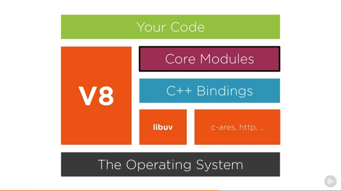

# Node.js Under the Hood

## Single Thread



## Call Stack
```js
function multiply (x, y) {
    return x * y
}

function printSquare (x) {
    const s = multiply(x, x)
    console.log(s)
}

printSquare(5)
```

```js
function foo () {
    throw new Error('Exception');
}

function bar () {
    foo()
}

function start () {
    bar()
}

start()
```

```js
console.log('script start')

const interval = setInterval(() => {
  console.log('setInterval')
}, 0)

setTimeout(() => {
  console.log('setTimeout 1')

  Promise.resolve()
    .then(() => console.log('promise 3'))
    .then(() => console.log('promise 4'))
    .then(() => {
      setTimeout(() => {
        console.log('setTimeout 2')
        Promise.resolve().then(() => console.log('promise 5'))
          .then(() => console.log('promise 6'))
          .then(() => clearInterval(interval))
      }, 0)
    })
}, 0)

Promise.resolve()
  .then(() => console.log('promise 1'))
  .then(() => console.log('promise 2'))
```